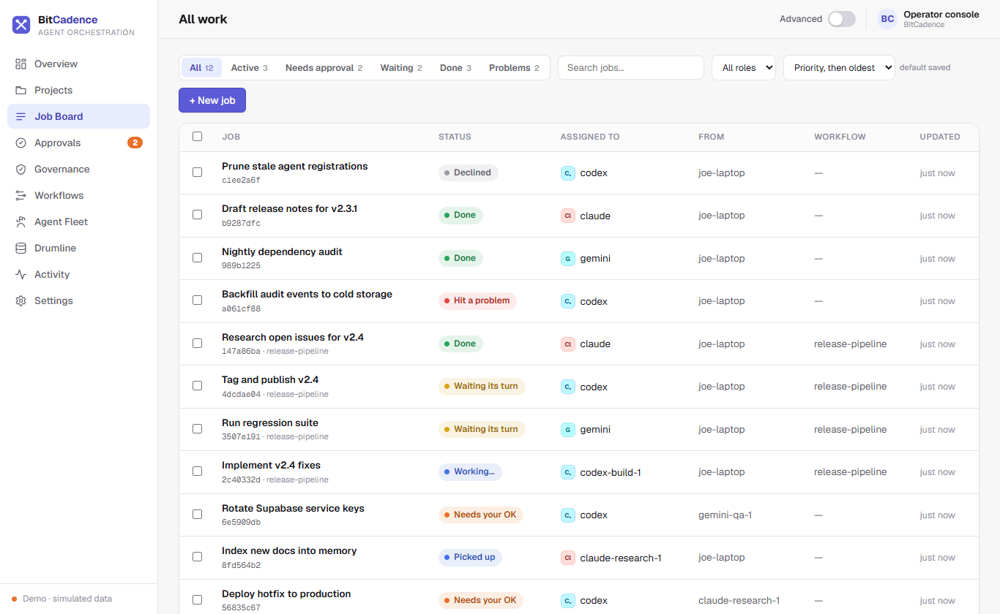
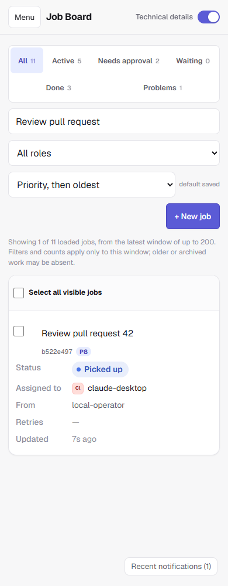
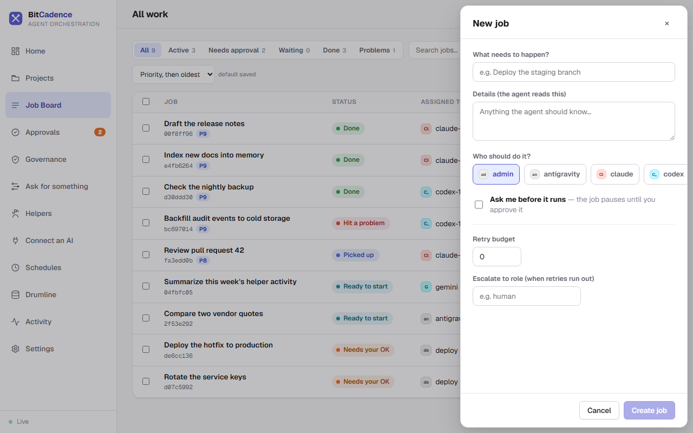
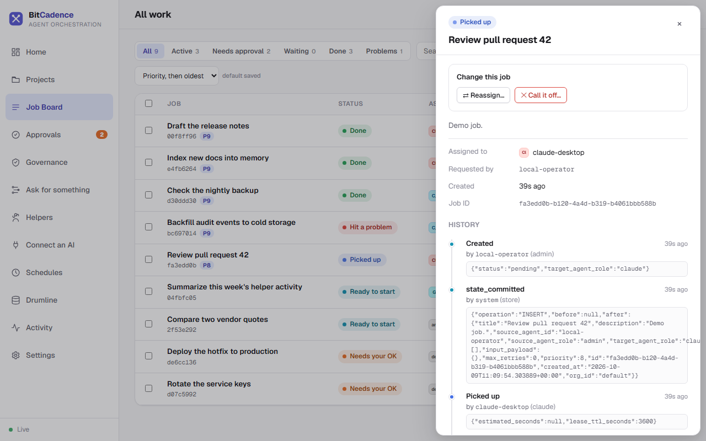

# Job Board & Managing Tasks

## Goal
Submit new tasks to helper dropboxes, inspect real-time queue states, examine tamper-evident execution drawers, and manage task lifecycles (retries, cancellations, reassignments, and archiving).

---

## Step-by-Step Instructions

### 1. Open the Job Board
In the left menu, click **Job Board**. Its heading has the same name in both copy tones. The coverage sentence states the fetched window, at most 200 latest jobs; search and counts apply to that window.



### 2. Filter and Search Tasks
1. Use the tabs at the top to focus on one kind of work. Each shows a count:
   - **All**
   - **Active:** pending, leased or in progress.
   - **Needs approval:** paused at a human gate.
   - **Waiting:** waiting for an earlier step.
   - **Done**
   - **Problems:** failed, rejected, halted or cancelled.
2. Type in **Search loaded jobs** to filter the fetched window, pick **All roles**, or change sort (default **Priority, then oldest**). Native job-title/sort buttons and the sort dropdown support keyboard operation.

### On a phone
At widths up to 760px, each job becomes a stacked row rather than seven squeezed columns. The title has its own wide area; **Status**, **Assigned to**, **From**, **Workflow** (or **Retries** with Technical details on), and **Updated** appear below it with labels. Long identifiers wrap within their field. Filter buttons wrap between buttons rather than splitting their words.

Use **Sort jobs** to change order; the desktop-only sortable column headings are hidden on phones. **Select all visible jobs** stays above the rows. Tap a row's checkbox area to select it without opening details, or tap its title to open the drawer. Selection, eligible batch actions and partial-result behavior are the same as on desktop. Escape closes a drawer when using a keyboard.



### 3. Creating a New Job
For most work, [Ask for something](Ask.md) is easier. To drop one job on the board yourself:
1. Click **+ New job** in the upper right.
2. Fill out the panel:
   - **What needs to happen?** A plain-English summary (for example, *"Summarize repository changes"*).
   - **Details:** anything the helper should know. It reads this.
   - **Who should do it?** Pick a role: `claude`, `codex`, `antigravity` and so on.
   - **Ask me before it runs:** tick this if the job must pause for your approval first.
   - **Retry budget:** how many automatic retries if the helper fails.
   - **Escalate to role:** where it goes when retries run out.



3. Click **Create job**. Submission is guarded while pending; an error retains the open form's values. Verify the actual created job. Dismissing an unsaved form does not save a persistent draft.

### 4. Inspecting Job Details & History
Choose a job title/open control. The panel can fetch that exact job ID outside the board's latest window:
- **Header:** the status word and the job title.
- **Change this job:** the actions that make sense for its state (see below).
- **Assigned to / Requested by / Created / Job ID.**
- **History:** an append-only timeline: created, picked up, completed or failed, and so on.



### 5. Managing Job Actions
Under **Change this job**, depending on the job's state:
- **Approve / Reject:** when the job needs your OK. See [Approvals](Approvals.md).
- **Retry:** puts a failed or rejected job back in line.
- **Reassign…:** for failed/rejected/cancelled/halted attempts, creates replacement work for a selected role. Active work must be cancelled first; completed work is ineligible. Inspect the returned replacement identity/link.
- **Call it off…:** stops an in-flight or waiting job.
- **Archive:** batch action for eligible finished work. Unarchive is available through the CLI; this console has no matching unarchive button.

Batch requests include only eligible visible selected jobs. Results show succeeded/failed/skipped with reasons; failures stay selected and results survive navigation in this session. Cancel a reason prompt to submit nothing. Failed individual actions keep their input while the editor remains open. An accepted request is not proof of execution completion. See [complete controls](gui-reference.md#batch-controls).

---

## The CLI Equivalent

Every Job Board action maps directly to the `mco` command-line tool:

```powershell
# Drop a new job into a helper's inbox
mco send codex `
  --title "Summarize the repository" `
  --message "Review recent commits on main and summarize changes." `
  --approve

# Inspect tamper-evident audit history
mco audit <job-id>

# Check for duplicate tasks
mco duplicates <job-id>

# Retry a failed job
mco retry <job-id>

# Cancel a job
mco cancel <job-id>

# Reassign a job to a different role
mco reassign <job-id> --to-role claude

# Archive a completed job
mco archive <job-id>
```

---

## What You'll See

- **Atomic Leases:** When a worker picks up a job, the status changes from `pending` to `leased` / `in_progress`. The table stamps `leased_by_instance_id` with the worker's unique ID.
- **Tamper-Evident History:** The audit trail shows every transition with the exact actor ID and UTC timestamp. The database prohibits updating or deleting historical event rows.

---

## If It Goes Wrong

### 1. "Job stuck in 'waiting' status"
- **Cause:** The job has dependencies (`depends_on`) that have not yet reached `completed`.
- **Fix:** Open the Job Detail Drawer, check the **Depends on** field, and ensure the parent job finishes successfully.

### 2. "Job stuck in 'needs_approval' status"
- **Cause:** The job was created with governance enabled and is paused at a human gate.
- **Fix:** Go to the **Approval Queue**, review the instructions, and click **Approve**.

### 3. "Job immediately fails with 'S3 / Network / Tool error'"
- **Cause:** The helper crashed or encountered an unhandled exception during execution.
- **Fix:** Inspect the error message in the job panel. If transient, click **Retry**. If the assigned role cannot handle the task, click **Reassign** to route to another role.
