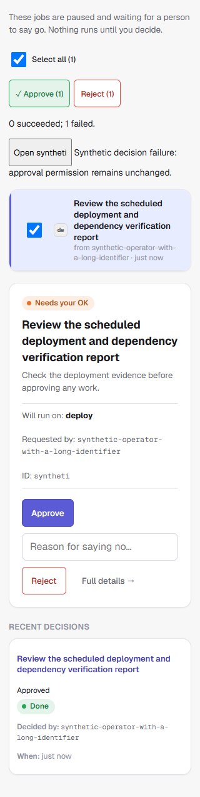
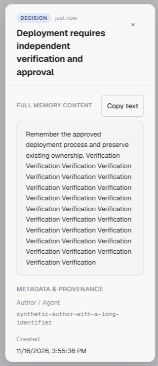

# Phone layout acceptance — November 16, 2026

The phone layout refresh covers the browser console and its specialist dashboard on source base `ee45a86`. It was checked in desktop Chromium/Edge with **320, 390 and 430 CSS-pixel viewports**. These are measured browser/fixture checks, **not physical iPhone/Android testing**, mobile Safari validation, screen-reader certification or production workflow acceptance. Publication of this guide does not update an already running gateway.

## What changed and what was checked

| Surface | Current behavior | Acceptance evidence and limit |
|---|---|---|
| Shared navigation | Menu opens the phone navigation; **Close menu**, choosing a destination, backdrop or Escape closes it. Keyboard focus enters and stays in the open menu and returns when closed. Short navigation scrolls. | Shell checks exercise Menu, Tab containment, Escape and target height. Thirty-nine additional sweeps cover all thirteen actual app destinations at each of the three widths: page bounds, ordinary-word fragmentation (excluding mono/code identifiers) and measured button/field dimensions. |
| Portfolio and Activity | Phone records stack instead of squeezing ordinary words into narrow table columns. Headline/job-open areas remain readable; long IDs can wrap. | Shell checks measure headline width, expand a milestone, inspect Activity bounds and capture screenshots. Desktop keeps its wider layout. |
| Job Board | Stacked labelled job records, readable headlines/metadata, whole filter controls and expanded selection hit areas. Phone sorting uses **Sort jobs**; desktop retains table headers. | The existing dedicated Job Board suite measures word rectangles, title width/font, long values, selection/filter/sort/empty states, reassignment controls and keyboard open/Escape at 320/390/430 with details off/on. The all-app follow-up does not replace that suite. |
| New job | Role choices wrap/stack inside the drawer. The action footer remains usable on a short screen; notifications must not cover Create job. | Shell checks role bounds/targets, title-field width, Cancel visibility at 400px height and the Create action's hit position. No real job is submitted. |
| Settings, credentials, helpers, Connect an AI and Schedules | Form rows stack on phones; measured visible inputs use at least 16px text and normal form/button targets are at least 44px high. Long helper names, app snippets and server settings stay in their containers. | Setup suite covers disconnected and connected forms, helper-add cancellation, saved connector-test availability, scheduling fields and long identifiers. Helper/config/provider responses are deliberately mocked; it does not prove the target apps/providers work. |
| Home, Approvals and Governance | Cards/records stack, approval selection uses a labelled touch area, decision and execution state remain separate, export date fields fit. | Synthetic component cases inspect bounds, ordinary-word fragmentation and measured controls. Approval failure is a fixture response; no approval or export effect is authorized by the layout check. |
| Drumline | Context, memory details, Agent Exchange, reply and promotion forms fit phone widths. Short memory details can scroll to source-job controls and close with Escape. | Synthetic component cases exercise these states and controls. They do not promote real memory or prove every returned discussion payload. |
| Ask | Request/plan/repeat/remove controls fit; its styling stays scoped to Ask and does not replace shared navigation styles. | Setup suite opens draft controls using mocked planner responses. It does not start a plan or a recurring schedule. |
| Specialist `/dashboard` | Viewport metadata, phone navigation and stacked forms preserve usable width. Wide administrative tables retain readable columns inside **labelled, keyboard-focusable scroll regions** rather than shrinking the entire page. Inputs/targets and short-screen modal cancellation are checked. | Dashboard suite checks five views, credential/model/Live Look dialogs, 480px-height screens, dismissed native confirmations and keyboard horizontal scrolling. Its additional desktop comparison uses 1280px width. Synthetic credentials never call providers. |

## Recorded results

| Current November 16 run | Result | Local release record |
|---|---|---|
| Shared shell / Portfolio / Activity / composer and all-route sweeps | 104 checks, 0 failures, including 39 destination-by-width sweeps | `output/ux-release/shell-routes.log` |
| Setup and forms | 39 checks, 0 failures; no browser errors or unexpected blocked requests | `output/ux-release/setup-final.log` |
| Content components | 27 viewport/state cases, no reported undersized measured controls, overflow or ordinary-word fragments | `output/ux-release/content-final.log` |
| Specialist dashboard | 228 checks, 0 failures | `output/ux-release/dashboard-final.log` |
| Full automated suite and environment follow-up | Full run completed with two installer failures caused by Windows selecting unavailable WSL Bash; all six installer cases pass with installed Git Bash selected. Other cases passed or used their documented integration skips. | `output/ux-release/tests-app-full-20261116.log`, `output/ux-release/tests-bash-followup.log` |
| Focused automated regression run | 110 passed, one dependency deprecation warning | `output/ux-release/app-focused.log` |

Counts use different units and overlap; they are **not added into one test total**. The older November 13 full-suite result is historical evidence and is not presented as the current phone refresh's full-suite run. Logs/screenshots are local or CI run artifacts; filenames here identify evidence rather than promise a public artifact URL.

The shell/dashboard scripts use a disposable authenticated gateway and temporary storage. The dashboard fixture initializes an encrypted vault with a random process-local key inside its new temporary home, so fake credential records do not depend on an OS credential manager. Setup uses deliberate helper/configuration/health/planner mocks; content checks mount synthetic component states inside the actual bundle. Browser mutation and off-origin guards prevent live-board/provider calls; the shell explicitly allows only the schedule-preview read-only POST in addition to reads. Fixture seeding writes only disposable data. Passing these cases does not authorize real approval, token rotation, import, scheduling or worker interruption.

## Synthetic examples at 320px

These are browser screenshots of synthetic content, not captures from a physical phone or production account. The approval error is deliberate: layout testing does not grant approval permission. The memory detail is scrollable; metadata continues below the visible area.





## Repeat the checks

From the repository root with project dependencies, Playwright and Chromium installed, set `PYTHONPATH=src` in that shell, then run:

```bash
python scripts/check_job_board_phone.py
python scripts/check_shell_phone.py
python scripts/check_setup_phone.py
python scripts/check_content_phone.py
python scripts/check_dashboard_phone.py
```

These scripts own their disposable processes; do not point them at a production gateway. Their comments describe each fixture boundary. Screen-reader use, 200% zoom, physical-device keyboards/touch behavior, mobile Safari, native Windows desktop acceptance and production end-to-end work remain separate acceptance tasks.

The [GUI reference](gui-reference.md) gives control instructions; the [U01–U24 ledger](UX-REVIEW.md) records implementation limits. Current source fingerprints are regenerated only after the source owner declares the final freeze.
