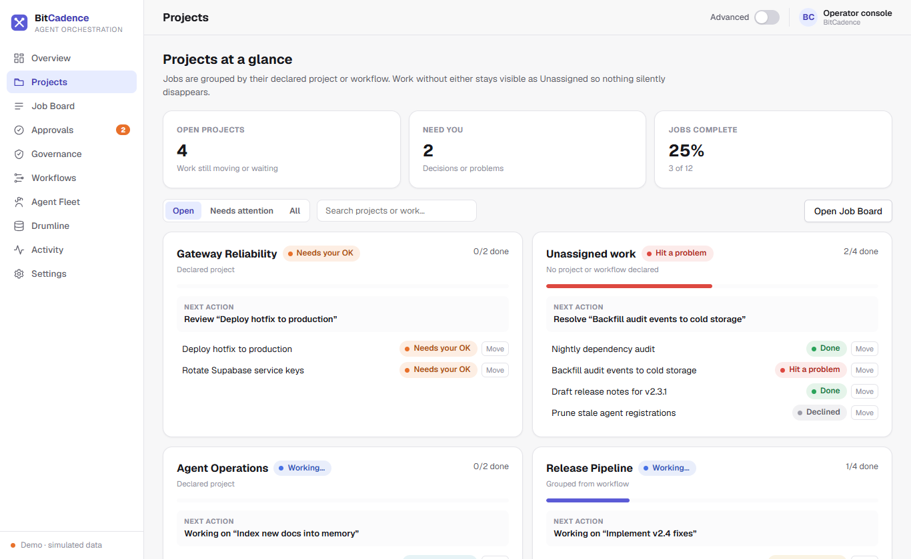

# Projects Dashboard

The sidebar now opens **Portfolio**. This retained URL explains current navigation and the separate project-assignment metadata/API. The previous Projects grouping screen and its Move buttons are not current console controls. See the [Portfolio controls](gui-reference.md#portfolio).

## Goal
Group disparate helper tasks into cohesive business projects and initiatives, observe project-level health and completion velocity, and detect blocked or stalled initiatives.

---

## Step-by-Step Instructions

### 1. Navigate to Projects
Choose **Portfolio** in the sidebar. Saved navigation from the older Projects page maps there. No project-assignment mutation occurs by opening the view.



### 2. Inspect Project Groups
Portfolio shows project roadmap/queue/flow information from its aggregate snapshot. Expand a project card, inspect recent job links or pull-request links, and use Refresh/Try again to reload. Priority/pause lines are explicitly read-only placeholders. See the [complete Portfolio steps and limits](gui-reference.md#portfolio); the old Open/Needs attention filters and Move controls are not exposed here.

### 3. Filter Jobs by Project
Choose **Job Board** from the sidebar to inspect its latest loaded job window. Its filters/search are not complete historical search or an automatic project filter.

### 4. Assigning a Job to a Project
The console New Job form has no arbitrary JSON/project field. Use an authorized metadata/API path when assigning a project. A job payload may carry project context such as:
  ```json
  {
    "project": {
      "id": "gateway-reliability",
      "name": "Gateway Reliability"
    }
  }
  ```

---

## The CLI Equivalent

You can inspect and assign projects from the command line:

```powershell
# Assign an existing job to a project
curl -X POST http://127.0.0.1:18789/api/jobs/<job-id>/project `
  -H "Authorization: Bearer $env:MCO_AGENT_TOKEN" `
  -H "Content-Type: application/json" `
  -d '{"project": "gateway-reliability"}'

# Fetch project-level aggregate view
curl http://127.0.0.1:18789/api/jobs/project-view `
  -H "Authorization: Bearer $env:MCO_AGENT_TOKEN"
```

---

## What You'll See

- **Portfolio:** its current cards reflect the aggregate snapshot, not the removed grouping screen. Respect its fetched-snapshot limits.
- **Project-view API:** the separate legacy `/api/jobs/project-view` result has a 5,000-job ceiling and can be partial; do not interpret it as an unbounded history.

---

## If It Goes Wrong

### 1. "Jobs have no project assignment"
- **Cause:** Jobs were created without a `project` key in their `input_payload`.
- **Fix:** If authorized, set explicit project metadata using the API above. A workflow fallback can still group work when explicit assignment is cleared. Portfolio may organize its aggregate differently from the old grouping view.

### 2. "Project marked as Blocked"
- **Cause:** A prerequisite job in a workflow failed or was rejected, stopping downstream dependent tasks.
- **Fix:** Open the actual linked job and inspect its cause. Retry or replacement work may be appropriate for eligible terminal attempts; neither guarantees that downstream work has completed.
