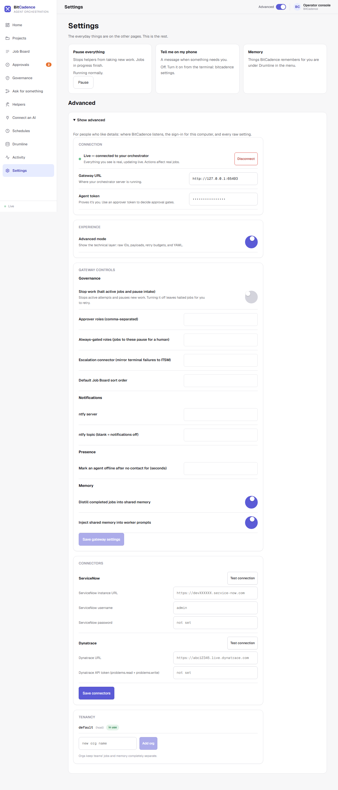

# Settings & Configuration

## Goal
Configure gateway operational parameters, customize user interface preferences, inspect edition capabilities, and connect enterprise tools.

---

## Step-by-Step Instructions

### 1. Open Settings
Click **Settings**. Disconnected connection fields appear directly; once connected the everyday cards are **Stop work**, **Tell me on my phone** and **Memory**. Expand **Server administration** for specialist fields (see [Settings](Settings.md)). Older screenshots may show previous labels.



### 2. Advanced mode
Under **Server administration → Experience**, **Technical details** shows IDs, payloads and retry fields. The same topbar switch changes only display, never permissions. Use **Administration** to discover helper credentials and the retained specialist dashboard screens.

### 3. Gateway controls
Under **Server administration → Gateway controls**, edit operational fields and metadata choices, then **Save gateway settings**. Only changed fields are submitted. A stop request confirms its effect. **Stop work… → Stop work now** halts active attempts and pauses intake; Resume permits new work but does not retry halted jobs. Cancel changes nothing.

### 4. Connectors and tenancy
- **Connectors** holds ServiceNow/Dynatrace fields. Choose **Save connectors**, then **Test connection**. Unsaved edits invalidate prior tests and disable import availability. A successful current test offers **Import now**, which can create/update work. Blank secret fields preserve saved secrets; no import dry-run is provided.
- **Tenancy** lists the organizations that keep teams' jobs and memory separate. The edition decides which of these you have: Core covers the job board, governance, workflows, Drumline memory, console and MCP server; Team adds shared gateway, multi-tenant orgs and RBAC; Enterprise adds connectors, SSO and audit export. Run `mco edition` to see yours.

---

## The CLI Equivalent

Manage configuration and secrets securely from your terminal:

```powershell
# Interactive setup walkthrough or menu
mco setup

# Inspect current settings
mco settings

# Update a setting safely
mco settings MCO_DRUMLINE_DISTILL true

# Show active edition and feature availability
mco edition

# Run complete install diagnostics
mco doctor
```

---

## What You'll See

- **Automatic Secret Encryption:** Whenever you set a sensitive key (such as `ANTHROPIC_API_KEY` or `SERVICENOW_TOKEN`), BitCadence writes `encrypted_in_secret_store` to `.env` and encrypts the real secret inside `secrets.enc`.
- **Apply timing:** The API applies supported settings and records changes. Respect field-specific restart requirements, such as structured logging; a saved setting is not proof of completed work.

---

## If It Goes Wrong

### 1. "Secret store locked: OS keychain unavailable"
- **Cause:** On Linux headless servers, Windows Credential Manager is not present.
- **Fix:** Set the master vault key in your environment:
  ```bash
  export MCO_VAULT_MASTER_KEY="your-32-byte-hex-key"
  ```

### 2. "Feature requires Team/Enterprise edition"
- **Cause:** Attempting to use a connector or multi-org tenancy while edition is set to `community`.
- **Fix:** Pin the edition in your `.env` or run:
  ```powershell
  mco settings MCO_EDITION enterprise
  ```
